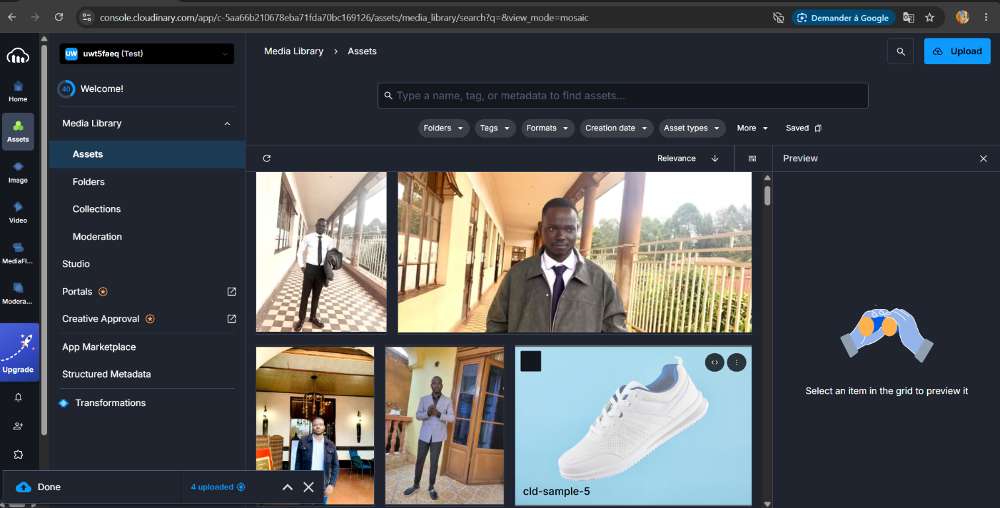

# IR GUILLAUME OSTOKO — Mon album photo

J'ai créé ce site pour présenter quatre photos personnelles dans une galerie que l'on peut consulter sur ordinateur comme sur téléphone. Je voulais une page simple et chaleureuse : on découvre d'abord mon album, puis on peut ouvrir les photos, les rechercher, les filtrer et partager leurs liens. J'y ai aussi ajouté quelques mots sur les souvenirs et les lieux que ces images me rappellent.

## Capture de mon espace Cloudinary

J'ai ajouté cette capture de la bibliothèque Cloudinary que j'ai utilisée pour retrouver mes images. Elle montre l'espace média et les fichiers disponibles dans Cloudinary. **Cette capture représente la bibliothèque de gestion, pas le design du site** : sur mon site, les photos sont présentées dans un album personnel différent.



## Les photos de mon album

J'ai hébergé mes quatre images sur Cloudinary. Je peux cliquer sur les aperçus ci-dessous pour ouvrir chaque image originale.

1. **Sur le campus** — [ouvrir l'image originale](https://res.cloudinary.com/uwt5faeq/image/upload/v1794504259/WhatsApp_Image_2026-11-12_at_18.15.34.jpg)
2. **Un instant de passage** — [ouvrir l'image originale](https://res.cloudinary.com/uwt5faeq/image/upload/v1794504258/WhatsApp_Image_2026-11-12_at_18.jpg)
3. **Élégance au quotidien** — [ouvrir l'image originale](https://res.cloudinary.com/uwt5faeq/image/upload/v1794504258/WhatsApp_Image_2026-11-12_at_18.1.jpg)
4. **Un lieu à part** — [ouvrir l'image originale](https://res.cloudinary.com/uwt5faeq/image/upload/v1794504258/WhatsApp_Image_2026-11-12_at_18.15.jpg)

## Comment utiliser mon site

- Je peux cliquer sur une des deux grandes photos d'accueil ou sur une photo de la galerie pour ouvrir sa fiche.
- Dans la fiche, je peux passer à la photo précédente ou suivante, ouvrir l'image originale, copier son lien, la télécharger ou la partager depuis mon téléphone ou mon navigateur.
- Sur téléphone, la fiche photo s'adapte à la hauteur de l'écran : l'image reste entièrement visible, le contenu de la fiche peut défiler et je peux passer d'une photo à l'autre avec les boutons ou en faisant glisser l'image.
- Je peux filtrer l'album par **Portraits**, **Quotidien**, **Lieux** ou afficher seulement mes **Favoris**. Je peux ajouter ou retirer une photo de mes favoris avec l'étoile ; mon navigateur mémorise ce choix.
- Je peux taper un nom ou un mot descriptif dans la recherche. La touche `/` place le curseur directement dans le champ.
- Je peux trier les photos par nom ou par date d'ajout.
- La fenêtre d'une photo se ferme avec la croix, en cliquant à l'extérieur ou en appuyant sur `Échap`. Les touches `←` et `→` permettent de changer de photo.
- J'ai adapté la mise en page aux écrans mobiles : sur téléphone, les photos s'affichent en une colonne, les textes restent lisibles et les commandes restent accessibles.
- Après la galerie, j'explique ce que ces souvenirs représentent pour moi. Les repères verts, terre cuite et bleus différencient les catégories sans surcharger les photos.

## Les fichiers du projet

J'ai gardé tous les fichiers à la racine du projet : il n'y a pas de sous-dossier à installer.

```text
index.html             La page, ma galerie et les fiches photo
styles.css             Le design et l'adaptation aux écrans mobiles
script.js              Les images, les filtres et les interactions
README.md              Cette présentation et mes explications
cloudinary-library.png La capture de ma bibliothèque Cloudinary
```

Le site utilise seulement HTML, CSS et JavaScript. Je n'ai besoin ni d'installer un paquet ni de lancer une compilation. Une connexion Internet est nécessaire pour charger les images et les polices web.

## Ouvrir le site

Je peux ouvrir directement `index.html` dans un navigateur. Pour utiliser un petit serveur local, j'ouvre PowerShell dans le dossier du projet et j'exécute :

```powershell
py -m http.server 5500
```

J'ouvre ensuite <http://localhost:5500>. Pour publier mon site, je peux envoyer les cinq fichiers à la racine d'un hébergement de site statique, par exemple GitHub Pages ou Netlify.

## Comment j'utilise Cloudinary

Mon espace Cloudinary héberge les originaux. Chaque carte ouvre une fiche contenant un lien direct vers son fichier. Pour afficher les photos rapidement dans la page, j'utilise aussi les transformations Cloudinary `f_auto`, `q_auto` et `w_720,c_limit` : Cloudinary choisit un format adapté au navigateur, optimise la qualité et limite la largeur de l'aperçu. Ces transformations ne modifient pas l'original.

Les liens de mes originaux suivent ce modèle :

```text
https://res.cloudinary.com/uwt5faeq/image/upload/<version>/<nom-du-fichier>
```

Pour ajouter une photo, je la téléverse d'abord dans mon compte Cloudinary. J'ajoute ensuite une entrée au tableau `media` dans `script.js`, avec son nom, son identifiant Cloudinary, sa catégorie, son texte alternatif et sa description. Je n'ajoute jamais de clé API ni de secret Cloudinary dans les fichiers du site.

## Vérifier les interactions

Quand je teste le site, je vérifie que les quatre photos se chargent, que les filtres et la recherche mettent bien la galerie à jour, et que je peux ajouter une étoile à une photo. J'ouvre ensuite une fiche pour essayer les boutons **Copier le lien**, **Partager** et **Télécharger l'image originale**. Enfin, je réduis la fenêtre du navigateur ou j'ouvre le site sur mon téléphone pour vérifier la mise en page mobile.
